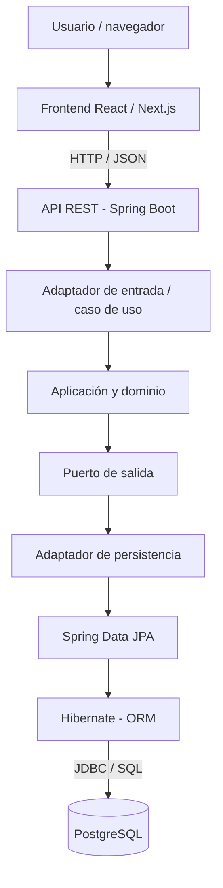

# UADE · Módulo 2 — Aplicaciones Interactivas

## Laboratorio de arquitectura empresarial y persistencia de datos con Java

**Tecnologías:** Java 21 · Spring Boot · Spring Data JPA · Hibernate · PostgreSQL · Maven · Docker Compose · Eclipse IDE

> **Estado:** ejercicio en preparación. La ejecución local y las pruebas deben verificarse antes de marcar el laboratorio como completado.

## 1. Propósito académico

Este repositorio documenta un ejercicio práctico de Ingeniería de Software: comprender cómo una aplicación empresarial implementada con **Java y Spring Boot** accede a información persistente mediante **Spring Data JPA, Hibernate y PostgreSQL**.

La práctica parte de un proyecto real existente en GitHub, en lugar de construir una aplicación desde cero. El foco es **analizar una arquitectura, identificar responsabilidades y demostrar una operación de escritura y otra de lectura**.

### Resultados de aprendizaje

Al finalizar, el estudiante podrá:

- Identificar una necesidad del negocio y traducirla en un caso de uso de software.
- Distinguir frontend, API REST, aplicación, dominio y persistencia.
- Explicar las diferencias entre **JPA** (especificación), **Hibernate** (implementación ORM), **Spring Data JPA** (abstracción de repositorios) y **JDBC** (acceso a la base de datos).
- Reconocer anotaciones como `@Entity`, `@Table`, `@Id` y `@Column` en el código existente, cuando corresponda.
- Seguir el recorrido de una solicitud HTTP hasta PostgreSQL y su respuesta.
- Verificar que una operación realmente modifica o consulta datos persistentes.

## 2. Caso empresarial: Ghost Load

El proyecto de referencia es **Ghost Load**, una aplicación empresarial orientada a evaluar la eficiencia y la capacidad no productiva de centros de datos. Su documentación describe funcionalidades de registro de operadores, evaluaciones, indicadores, benchmarks y generación de reportes.

**Repositorio original:** [No-Country-simulation/S07-26-Team-26](https://github.com/No-Country-simulation/S07-26-Team-26)

Este repositorio académico **no se presenta como autor del software original**. Se utiliza como caso de estudio y deben conservarse los avisos de licencia y atribución aplicables. Revisar la licencia del repositorio fuente antes de redistribuir su código.

### Escenario elegido

**Registrar un operador y crear o recuperar una evaluación.**

El ejercicio deberá identificar en el código real:

1. Una operación de escritura: solicitud HTTP → caso de uso → persistencia en PostgreSQL.
2. Una operación de lectura: consulta en PostgreSQL → backend → respuesta HTTP.
3. La entidad, el repositorio y el adaptador de persistencia involucrados.

> **Importante:** los nombres exactos de clases, rutas HTTP y tablas se completarán después de que Codex los verifique en el repositorio. No deben inventarse endpoints ni modificar la arquitectura original para que coincida con un ejemplo genérico.

## 3. Arquitectura conceptual



**Nota arquitectónica:** Ghost Load documenta un **monolito modular con arquitectura hexagonal**. Por eso, el recorrido real puede incluir puertos y adaptadores en lugar de la secuencia simplificada `Controller → Service → Repository`. Se deben respetar las clases y dependencias efectivamente implementadas.

## 4. Tecnologías y responsabilidades

| Componente | Responsabilidad |
|---|---|
| Java 21 | Lenguaje y entorno de ejecución del backend. |
| Spring Boot | Configuración y ejecución de la aplicación. |
| Spring Web / MVC | Exposición de endpoints HTTP. |
| Spring Data JPA | Interfaces y operaciones de repositorio. |
| JPA (Jakarta Persistence) | Especificación de persistencia objeto-relacional. |
| Hibernate | Implementación ORM y gestión de entidades. |
| JDBC / driver PostgreSQL | Comunicación con el motor de base de datos. |
| PostgreSQL 16 | Almacenamiento relacional persistente. |
| Flyway | Versionado de cambios en el esquema de base de datos. |
| Maven | Gestión de dependencias y construcción del backend. |
| Docker Compose | Ejecución coordinada de los servicios locales. |
| Eclipse IDE | Lectura, edición y depuración del código Java. |

## 5. Requisitos del entorno

Para reproducir la aplicación completa en una computadora Windows:

- Git.
- JDK 21.
- Docker Desktop con Docker Compose y los requisitos de virtualización correspondientes.
- Eclipse IDE con soporte Maven (recomendado para estudiar el código).
- Acceso a internet para descargar dependencias e imágenes de contenedores.

**No es obligatorio instalar PostgreSQL directamente en Windows:** el proyecto original incluye un servicio PostgreSQL mediante Docker Compose. Tampoco es necesario generar otro proyecto en Spring Initializr: el backend y su `pom.xml` ya existen.

## 6. Obtener el proyecto de referencia

```powershell
git clone https://github.com/No-Country-simulation/S07-26-Team-26.git
cd S07-26-Team-26
```

Crear una rama de trabajo para experimentos locales, sin modificar la rama principal del proyecto original:

```powershell
git switch -c laboratorio-jpa
```

### Configuración local

El README del proyecto fuente indica crear `backend/.env` desde su plantilla:

```powershell
Copy-Item backend/.env.example backend/.env
```

Completar las variables requeridas con valores **solo de desarrollo**. No publicar contraseñas, tokens, archivos `.env` ni claves de API.

## 7. Levantar los servicios

Desde la **raíz del proyecto original**, una vez configurado Docker Desktop y el archivo `.env`:

```powershell
docker compose --env-file backend/.env up --build
```

Según la documentación del repositorio original, los servicios locales previstos son:

| Servicio | Dirección local esperada |
|---|---|
| Frontend | `http://localhost:3001` |
| Backend | `http://localhost:8080` |
| PostgreSQL | `localhost:5432` |

**Estas direcciones son las documentadas, no una confirmación de que estén activas en tu computadora.**

Para comprobar la salud del backend, el repositorio documenta:

```powershell
curl.exe http://localhost:8080/actuator/health
```

Para detener los servicios:

```powershell
docker compose --env-file backend/.env down
```

> No ejecutar `down -v` durante la práctica: esa opción puede eliminar volúmenes y datos persistentes.

## 8. Abrir el código en Eclipse

1. Abrir Eclipse y seleccionar el JDK 21.
2. Elegir **File → Import → Maven → Existing Maven Projects**.
3. Seleccionar la carpeta `S07-26-Team-26/backend`.
4. Importar el proyecto detectado a partir de `pom.xml`.
5. Explorar `src/main/java` y `src/main/resources`.
6. Identificar la clase principal, las entidades JPA, los repositorios y los adaptadores de persistencia.

Si el backend ya se ejecuta en Docker, evitar iniciar una segunda instancia en el mismo puerto `8080` sin ajustar la configuración.

## 9. Actividad práctica: seguir el recorrido de los datos

### Parte A — Reconocimiento

Localizar en el código fuente real:

- El controlador o adaptador de entrada del caso elegido.
- El caso de uso o servicio de aplicación.
- Los puertos de salida, si corresponden.
- El adaptador de persistencia y el repositorio Spring Data JPA.
- Las clases anotadas con JPA.
- La configuración de PostgreSQL y las migraciones Flyway.

Registrar sus **rutas exactas** en la sección de evidencias.

### Parte B — Escritura

Ejecutar una solicitud válida para registrar un operador o crear una evaluación, utilizando **un endpoint existente y verificado**. Observar:

- Método HTTP y respuesta.
- Validaciones y reglas de negocio.
- Invocación del repositorio o adaptador.
- Persistencia del registro en PostgreSQL.

### Parte C — Lectura

Ejecutar una consulta existente que permita recuperar el registro o su resultado. Comprobar que la información proviene del almacenamiento persistente y no solamente de un objeto temporal en memoria.

### Parte D — Verificación SQL

Conectarse a PostgreSQL usando una herramienta autorizada (por ejemplo, `psql` o pgAdmin), identificar la tabla correspondiente y realizar una consulta `SELECT` de **solo lectura** para verificar el resultado. No asumir nombres de tablas o columnas antes de inspeccionar el esquema.


**Sugerencia docente:** instalar y levantar todo **antes de comenzar la exposición**. La instalación completa de herramientas no forma parte de los 20 minutos de demostración.

## 11. Evidencias y checklist

- [ ] Entorno Java 21 verificado.
- [ ] Docker Compose funcionando.
- [ ] Proyecto clonado e importado en Eclipse.
- [ ] Backend iniciado sin errores.
- [ ] PostgreSQL accesible.
- [ ] Entidad JPA y repositorio identificados.
- [ ] Operación de escritura ejecutada correctamente.
- [ ] Operación de lectura ejecutada correctamente.
- [ ] Persistencia comprobada mediante SQL.
- [ ] Capturas o registros de la demostración incorporados.

### Archivos reales del flujo seleccionado

| Elemento | Ruta verificada | Función |
|---|---|---|
| Endpoint / controlador | Pendiente | Entrada HTTP |
| Caso de uso / servicio | Pendiente | Lógica de aplicación |
| Adaptador de persistencia | Pendiente | Acceso a datos |
| Entidad JPA | Pendiente | Mapeo objeto-relacional |
| Repositorio | Pendiente | Operaciones de persistencia |
| Migración / tabla | Pendiente | Esquema de PostgreSQL |


## 13. Fuentes y atribución

- [Repositorio Ghost Load — No Country Simulation](https://github.com/No-Country-simulation/S07-26-Team-26)
- [Spring Boot](https://spring.io/projects/spring-boot)
- [Spring Data JPA](https://spring.io/projects/spring-data-jpa)
- [Hibernate ORM](https://hibernate.org/orm/)
- [PostgreSQL](https://www.postgresql.org/)
- [Docker Compose](https://docs.docker.com/compose/)

---

**UADE · Módulo 2 — Aplicaciones Interactivas**  
*Caso académico de arquitectura y persistencia empresarial. La ejecución práctica debe verificarse en el entorno local.*
